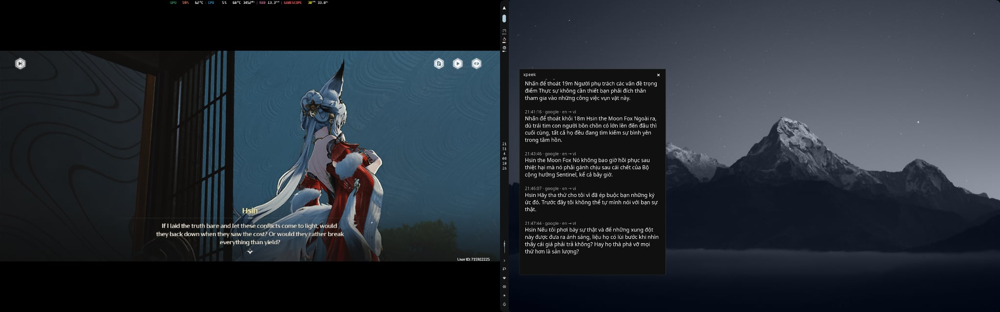

# xpeek

Copy and translate screen text on Linux/Wayland. Mainly developed for gaming dialogue and subtitles; other use cases have not been thoroughly tested. Select a region, then translate its text in a popup or copy it to your clipboard.



## Install

Requires distro Python 3.10+, GTK4/PyGObject, `grim`, `slurp`, and `wl-copy`. Install `gtk4-layer-shell` for independent popup placement on niri and other layer-shell desktops.

```bash
# Arch / CachyOS
sudo pacman -S python python-pip python-gobject gtk4 gtk4-layer-shell grim slurp wl-clipboard
git clone https://github.com/znp0/xpeek.git
cd xpeek
python3 setup.py install
```

Setup asks which OCR engines to install: RapidOCR, PaddleOCR tiny, or PaddleOCR small. A new config defaults to tiny if selected, otherwise RapidOCR, then small. Paddle uses a separate managed Python 3.12 runtime on glibc Linux, x86_64. To skip the prompt:

```bash
python3 setup.py install --ocr-engines rapidocr,paddleocr-tiny
python3 setup.py install --ocr-engines all # Install all three engines
```

Press Enter to accept the displayed engine selection (tiny on a fresh install; previous engines on updates). Non-interactive installs require `--ocr-engines`; missing or empty selections fail.

The installer creates `.venv`, downloads selected models/dependencies, links `~/.local/bin/xpeek`, and creates `~/.config/xpeek/config.json` if missing. Use distro Python; setup needs no `sudo`. Keep the checkout in place and rerun setup after updates. Existing config, saved region, popup geometry, and history are preserved. If needed, add `~/.local/bin` to your PATH:

```bash
export PATH="$HOME/.local/bin:$PATH"
```

Remove selected engines or uninstall from the same checkout:

```bash
python3 setup.py remove-engines paddleocr-small # Keep xpeek and the remaining engines
python3 setup.py uninstall                 # Keep configuration and state
python3 setup.py uninstall --remove-config # Also remove config, region, and popup state
```

Removing engines keeps config unchanged and requires at least one engine to remain; update `ocr_engine` if you remove its engine. Uninstall removes the managed environments, model downloads/caches, and command symlink. History and unrelated files are preserved; distro packages are managed separately. Clipboard notifications are optional and require `notify-send` plus a desktop notification daemon.

## Use

```bash
xpeek select                         # Save a screen region
xpeek --version                      # Show the installed version
xpeek translate                      # Translate the saved region
xpeek translate --persistent         # Append to one popup, keeping the latest 10
xpeek translate --ocr-engine paddleocr-small
xpeek translate --capture-backend gamescope # Capture native game pixels on niri
xpeek translate -p gemini -s auto -t vi
xpeek translate -p clipboard          # Copy text from the saved region
xpeek ocr                            # Select a temporary region and copy text
xpeek ocr -p google                   # Translate a temporary region
xpeek show-history -n 10              # Open recent translations
xpeek history --watch                 # Watch history in a scrollable terminal view
```

Normal translation calls toggle the single popup. Persistent mode appends results and follows new entries while you're at the bottom. Clipboard calls run independently; `ocr` never changes the saved region. Flags override config only for that invocation. See `xpeek --help`, command-specific help, and the [usage guide](docs/usage.md).

## Configure

Edit `~/.config/xpeek/config.json`; see [config.example.json](config.example.json) and the [configuration guide](docs/configuration.md). Translation starts with automatic source detection → English, using Google without an API key. Other providers are DeepL, OpenAI, Gemini, and Ollama.

Keep API keys in environment variables or the checkout's ignored `.env`:

```bash
cp -n .env.example .env
# Fill in DEEPL_API_KEY, OPENAI_API_KEY, or GEMINI_API_KEY as needed.
```

Exported variables take precedence. Use `provider_options` for non-secret settings such as models and hosts.

| OCR engine | Choose it for |
| --- | --- |
| `paddleocr-tiny` | Best tested balance of speed and dialogue retention |
| `rapidocr` | The existing lightweight ONNX engine |
| `paddleocr-small` | Cleaner text, with slower processing |

Set `ocr_engine` to your default engine; `--ocr-engine` overrides it for one command. Configure each engine separately in `ocr_options`:

| Option | Default | Usage |
| --- | --- | --- |
| `capture_backend` | `"desktop"` | `"desktop"` captures the displayed region; `"gamescope"` captures native game pixels on supported niri layouts, with desktop fallback. |
| `threads` | `1` | Integer 1–4. More threads can reduce processing time but increase CPU use; our tests favored one thread. This is not an OS CPU quota. |
| `scale` | `1` | Positive factor applied before OCR: `0.5` halves width and height, `1` keeps captured resolution. Downscaling uses area interpolation; enlarging uses cubic. |
| `preprocess` | `"none"` | Keep color with `"none"`, or use `"grayscale"` after resizing. Grayscale can change word boundaries and meaning. |

Merge these settings into your config for Tiny at native gamescope resolution and Small at half desktop resolution:

```json
{
  "ocr_engine": "paddleocr-tiny",
  "ocr_options": {
    "paddleocr-tiny": {"capture_backend": "gamescope", "threads": 1, "scale": 1, "preprocess": "none"},
    "paddleocr-small": {"capture_backend": "desktop", "threads": 1, "scale": 0.5, "preprocess": "none"}
  }
}
```

Then use `xpeek translate --ocr-engine paddleocr-small` to switch capture and OCR settings together. Omitted engine settings use desktop capture, one thread, original resolution, and color. These example combinations follow the Wuthering Waves results; compare your own dialogue before adopting them.

Tested on an Intel Core i7-12700H using 25 desktop captures of Wuthering Waves, rendered at 1280 × 800 and upscaled to 2560 × 1600. Warm OCR medians exclude startup, capture, and translation:

| Settings (one thread, color) | Time | Dialogue result |
| --- | ---: | --- |
| Tiny, `scale: 1` | 1.142 s | Preserved difficult clauses; our safe Tiny starting point |
| Tiny, `scale: 0.5` | 0.425 s | Lost an entire cinematic sentence |
| Small, `scale: 1` | 2.716 s | Preserved all annotated clauses and choices |
| Small, `scale: 0.5` | 1.172 s | Preserved all annotated clauses and choices; character error fell from 0.59% to 0.33% |

Small at `0.5` gave the best tested accuracy/speed balance without manual cropping on those upscaled images. Keep Tiny at `1`; grayscale sometimes changed a direction or subject, so color remains the default. Testing covered only Wuthering Waves on one machine; other games are untested. Compare your own dialogue before adopting reduced resolution. See the [OCR guide](docs/ocr.md) and [full benchmark results](docs/benchmarks.md), including native-resolution comparisons.

Capture defaults to `grim`, including gamescope upscaling. Set `capture_backend: "gamescope"` inside an engine's `ocr_options` or use `--capture-backend gamescope` for native-resolution capture on supported niri layouts. The saved or temporary region is mapped into the native game frame; unavailable capture falls back to desktop with a terminal warning. Start with OCR `scale: 1`, since scaling applies after capture. See the [capture guide](docs/capture.md) for setup and limitations.
